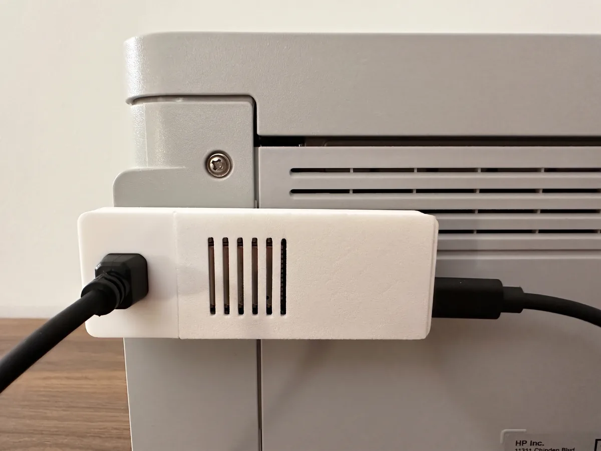

<p align="center">
  
</p>

<h1 align="center">Pluto Print</h1>

<p align="center">
  WiFi printing for Samsung printers, from an ESP32-S3.
</p>

<p align="center">
  <a href="https://unluckyquote.github.io/plutoprint/"><b>Install</b></a> &nbsp;·&nbsp;
  <a href="#what-you-need">What you need</a> &nbsp;·&nbsp;
  <a href="#using-it">Using it</a> &nbsp;·&nbsp;
  <a href="#case">Case</a> &nbsp;·&nbsp;
  <a href="#for-developers">For developers</a>
</p>

<p align="center">
  
  
  
</p>

<p align="center">
  
</p>

Pluto Print turns an **ESP32-S3** into a WiFi print server for a Samsung USB printer. The ESP32 plugs into the printer's USB port and appears on your network as an AirPrint printer, so an iPhone, iPad or Mac can print to a printer that has no WiFi of its own. You install it from a web page, with no tools to set up.

It's tested on a Samsung Xpress **M2020W** from iPhone, iPad and Mac.

## Features

- AirPrint over WiFi at 600 dpi, found automatically by iOS and macOS
- PWG raster as well as Apple raster, which should let Windows, Android and Linux print too (not yet tried on those)
- Paper sizes, trays and colour support read from the printer itself
- Copies work on any printer, because the ESP32 sends the stored document once per copy
- Toner level in the web page and in macOS "Supply Levels" (black only so far)
- A web page at `http://printer.local` with status, jobs, settings and firmware updates
- Optional password for the changing actions
- A failed or cancelled job never prints an error page, because documents are held in memory until they've fully arrived
- Firmware updates over WiFi, with automatic rollback if the new version can't start
- A snap-close 3D-printable case that clips onto the printer's USB-B plug

## What you need

| Part | Notes |
|---|---|
| ESP32-S3 DevKitC-1 style, **N16R8** (16 MB flash, 8 MB PSRAM) | The firmware needs the PSRAM and the 16 MB partition layout. |
| USB-C to USB-B cable | From the ESP32's **USB** port to the printer. |
| USB charger and USB-C cable | Into the **COM** port (labelled UART on some versions), for power and flashing. |
| Solder | The two **USB-OTG** pads on the underside must be bridged so the ESP32 can supply power to the printer's port. |
| Samsung printer | With a USB port. Tested on the M2020W. |
| A computer with Chrome or Edge | For the install. |

## Install

Open the **[installer](https://unluckyquote.github.io/plutoprint/)** in Chrome or Edge and follow the steps. They cover gathering the parts, bridging the USB-OTG pads, connecting the ESP32, installing and choosing your WiFi network. The ESP32 only joins **2.4 GHz** networks.

An ESP32 with no saved WiFi can also be set up without the installer:

1. **Setup hotspot.** It starts a network named `PlutoPrint-XXXX` (password `plutoprint`). Join it, open `http://192.168.4.1/`, and enter your WiFi under Settings.
2. **Serial.** Any tool that speaks [Improv WiFi](https://www.improv-wifi.com/) over serial can send the details.

## Using it

- **iPhone and iPad:** print from any app and choose **Pluto Print**.
- **Mac:** System Settings, Printers & Scanners, Add Printer, choose **Pluto Print** and leave "Use" on **AirPrint**. If macOS offers a Samsung driver instead, pick AirPrint from the list.
- **Windows, Android, Linux:** add an IPP printer at `ipp://printer.local:631/ipp/print`. Clients that send PWG or Apple raster work. Clients that only send PDF or PCL don't.
- **Raw port 9100** passes bytes straight to the printer. It's meant for Samsung's own drivers and isn't announced on the network.

### The web page

`http://printer.local` (or the ESP32's IP address) shows the printer state and toner, the last five jobs, and the settings: device name, location, hostname, colour and two-sided printing, how often the job list clears itself, WiFi and a password.

**Password.** Setting one asks for it (user name `admin`) before settings, WiFi, firmware updates, cancel and clear can be changed. Status and the job list stay readable. The page uses plain HTTP, so the password keeps casual users out but doesn't protect against someone listening on your WiFi. If you forget it, hold the **BOOT** button for 10 seconds while the ESP32 is running.

### Updating

Download the [update file](https://unluckyquote.github.io/plutoprint/firmware/pluto-print-update.bin) and upload it in the web page under Update. The ESP32 reboots into the new version and keeps it only if it starts all of its services. Otherwise it returns to the previous version by itself.

## Case

`hardware/case.scad` is a parametric [OpenSCAD](https://openscad.org/) model, and `hardware/case_print.stl` is the ready-to-print layout of the box and lid.

- Print the box floor down and the lid plate down, with supports for the USB-C holes. The pair prints in about 25 minutes in PLA.
- The USB-B opening grips the plug's plastic body, so the case holds itself on the back of the printer.
- The USB-B hole, the USB-C openings and the snap lid were fit-tested on printed coupons. If the lid is too loose or tight, change `bump` in 0.05 mm steps.
- It's made for a 57 x 28 mm ESP32-S3 with a 6 mm antenna beyond the module and 5 mm overall height. Other versions need other numbers at the top of the file.

## Limits

- Only the Samsung M2020W has been tested. Colour printing, two-sided printing and colour toner levels are written from the formats' documentation and haven't run on a real printer.
- A cancel while the printer is already receiving a page can leave it with an incomplete page.
- Jobs on port 9100 aren't listed or held in memory first.
- The clock isn't synchronised, so job ages count from when the job finished according to the ESP32's own clock.
- The web page is plain HTTP.

## For developers

### How it works

The printer decodes Apple raster (URF) and PWG raster itself, so the ESP32 renders nothing. It receives a job over IPP, keeps the whole document in PSRAM (up to 6 MB) until it has fully arrived, converts PWG raster to URF if needed, and sends it to the printer over USB once per copy, wrapped in a PJL language switch:

```
ESC%-12345X @PJL ENTER LANGUAGE=URF <document> ESC%-12345X
```

Nothing reaches the printer until the document is complete, which is what stops a dropped connection or a cancel from producing an "incomplete session" error page.

When a printer connects, the ESP32 reads its IEEE 1284 device ID and the Samsung status monitor file (paper sizes, trays, toner colours) over USB control requests, and advertises what it finds over IPP and Bonjour.

### Protocols and ports

| Port | Service |
|---|---|
| 631 | IPP at `/ipp/print` (Print-Job, Validate-Job, Cancel-Job, Get-Job-Attributes, Get-Jobs, Get-Printer-Attributes) |
| 80 | Web page and JSON API |
| 9100 | Raw passthrough |

Announced over mDNS: `_ipp._tcp` (with the `_universal` subtype) and `_http._tcp`.

USB: printer class 7, protocol 2 (bidirectional), bulk endpoints, Samsung vendor ID `0x04e8`. Control requests used: printer port status (`0xA1/0x01`), device ID (`0xA1/0x00`), Samsung status (`0xC1/0x02`, byte 4 is the black toner percentage) and the status monitor XML (`0xC1/0x0D`, read in 255-byte chunks after an 8-byte header that holds the total size).

### Layout

```
components/
  usb_printer/    USB host: bulk transfers, control requests, device ID, status file
  print_server/   IPP server, raw 9100, mDNS, attribute building, printer detection
  ipp/            IPP request parser and response writer
  raster_convert/ PWG raster to URF, grey and sRGB
  printer_caps/   parses the device ID and status XML
  pjl_frame/      PJL language-switch framing
  web_ui/         HTTP server, JSON API and the embedded web page
  wifi_mgr/       station and setup hotspot, scan, provisioning
  improv/         Improv WiFi over the serial port
  settings/       NVS-backed settings and the salted password hash
  job_log/        ring buffer of the last five jobs
  logbuf/         in-memory log, readable at /api/log
  ...
main/             start-up
hardware/         case (OpenSCAD and STL)
test/host/        unit tests that run on a computer
web/              the installer page for GitHub Pages
```

### Build and flash

You need [ESP-IDF](https://docs.espressif.com/projects/esp-idf/) 5.5.

```bash
idf.py set-target esp32s3
idf.py build
idf.py -p /dev/cu.usbserial-XXXX flash monitor
```

There are no WiFi credentials in the build. Set them after flashing, as described above. `sdkconfig.defaults` holds the PSRAM, flash size, partition table and rollback settings. The partition table has two 3 MB app slots for updates.

### Tests

The parsing and conversion code has unit tests that run on a computer, with no ESP32 needed:

```bash
make -C test/host test
```

### JSON API

`GET /api/status`, `/api/jobs`, `/api/settings`, `/api/wifi/networks` and `/api/log` are read-only. `/api/log` asks for the password when one is set.

`POST /api/settings`, `/api/wifi`, `/api/password`, `/api/jobs/cancel`, `/api/jobs/clear`, `/api/testpage`, `/api/reboot` and `/api/ota` change things. They need the header `X-Requested-With: printer-ui`, and HTTP Basic credentials (`admin`) when a password is set.

### Installer

`web/` is a static page that uses [ESP Web Tools](https://github.com/esphome/esp-web-tools) for the flashing and [three.js](https://threejs.org/) for the case viewer. Both are downloaded at build time from fixed, checksummed versions by `tools/vendor-web-libs.sh` and served from the same site, so the page loads nothing from other sites. Run that script once if you want to serve `web/` locally.

A GitHub Actions workflow (`.github/workflows/pages.yml`) runs the unit tests, builds the firmware, merges it into one image and publishes the page to GitHub Pages together with the update file. In the repository settings, set Pages to deploy from GitHub Actions.

## Privacy

The installer page collects nothing, sets no cookies and runs no analytics. It's hosted on GitHub Pages, so GitHub sees visitors' IP addresses under its own privacy statement, and that's the only service the page contacts. The two libraries it uses are served from the same site rather than from a content delivery network. The ESP32 itself doesn't contact any server, so your WiFi details and print jobs stay on your network. The page's [privacy notice](web/privacy.html) says the same in more detail.

## Contributing

Reports from other printers are especially welcome. See [CONTRIBUTING.md](CONTRIBUTING.md), and the [changelog](CHANGELOG.md) for what's in each release. [SECURITY.md](SECURITY.md) explains how to report a vulnerability.

## Licence and credits

Pluto Print is free software, licensed under the GNU General Public License version 3 or any later version. You can use, share and change it for any purpose. If you share a changed version, you have to share its source under the same licence. There is no warranty and no liability.

Please keep the credit "Pluto Print by UnluckyQuote" with a link to <https://github.com/unluckyquote/plutoprint>. `NOTICE.md` has the full wording and lists the software this builds on.
